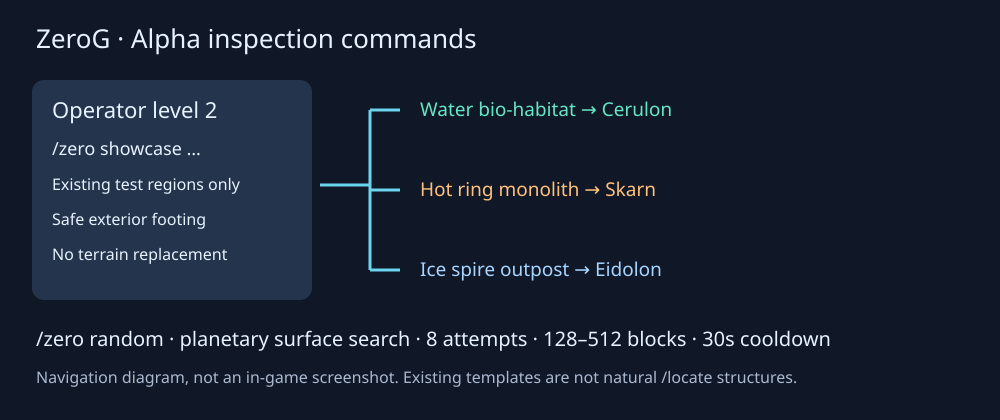

# Alpha inspection: structures and random travel

> Superseded showcase placement: the Kimi integration now uses saved grounded
> site positions, with `/zero showcase ice`, `water`, `hot` aliases and explicit
> `build` subcommands. See [current site guide](kimi-structure-sites-2026-10-14.md).
> The former512,90,512chest-marker instructions below are historical, not the
> current travel implementation.



All commands below require operator permission level 2. They are inspection
tools, not survival gate unlocks: no FE is spent, no keys granted, no landing
pads built and no permanent chunk tickets retained. Arrival milestones can still
unlock when visiting a planet.

## New structure shortcuts

Use the supplied `ZeroG_Workshop_Structures_20261013_Seed0` world:

```mcfunction
/zero showcase water_bio_habitat
/zero showcase hot_ring_monolith
/zero showcase ice_spire_outpost
```

These visit Cerulon, Skarn and Eidolon respectively, near the authored test
structures at template origin 512,90,512. A surviving supply chest is checked
before searching four exterior columns for safe footing. No structure is created
by this command. A missing chest/structure or unsafe exterior produces an error
without moving the player. These templates are not yet naturally registered
structures; `/zero locate` does not locate them. Existing placed versions are
not rewritten by a JAR update; the supplied save still contains the earlier
geometry, while new template placements use the repaired gallery clearances.

## Random exploration

```mcfunction
/zero tp moon
/zero random
/random
```

Random travel is restricted to the 34 ZeroG planetary dimensions, not the
Overworld or other mods' dimensions. It searches at most eight surface columns
128–512 blocks from the player, within the world border. It requires dry sturdy
footing and two clear blocks, rejects known dangerous floors/occupants, and
waits 30 seconds between attempts, even after an unsuccessful search.
At most eight ordinary chunks may load/generate; large generation can still
cause a brief server pause. It does not guarantee a village or structure nearby.
`/random` is only registered if that root is available; `/zero random` remains
the reliable namespaced command when another mod owns `/random`.

## Existing useful commands

| Command | Purpose |
| --- | --- |
| `/zero help` | Command overview |
| `/zero dimensions` | All destination aliases |
| `/zero tp <planet>` | Safe surface search near destination spawn |
| `/zero tp <planet> x y z` | Explicit inspection location; can be hazardous |
| `/zero home` | Return near Overworld spawn, not a personal bed |
| `/zero structures` | Registered natural structure names |
| `/zero locate <structure> [planet]` | Vanilla locate in selected dimension |
| `/zero gate x y z` | Formation, FE, ports and countdown diagnostics |
| `/zero machine x y z` | Loaded block's per-face item/fluid/power capabilities |
| `/zero status` | Current dimension/time and weather status |
| `/zero hub status` | Hub initialization status |

Explicit coordinate travel is not a universal safety check. Do not use these
tools to reset worlds or bypass the intended survival playtest.

## Alpha review and remaining work

Three required isolated command GameTests passed on 14 October. The disposable
server shut down normally. This is server evidence, not an in-game screenshot.

The normal build passed and excludes optional test classes. Installed with an
old-JAR backup while the client was closed; saves/configurations were unchanged.
Archive: `jars/zerog-tweaks-1.21.1-1.0.12-dev-admin-commands-20261014.jar`.
SHA256: `f85bb0e2d1ec13416209e8a05f7173ceb48d5ffd0e152fcde126d6b0ac08ab3f`.

Confirm client command suggestions, all three exterior arrivals and a planetary
random trip in game. Isolated tests cover permissions, registration, scope,
collision/hazard rejection and explicit cross-dimension travel; they do not
certify every naturally generated random destination or client transition art.
Natural registration/density of the three large concepts, reliable village
generation, black-cone vent artwork and final survival/research balance remain
pending. Do not label the whole mod alpha-ready solely from this command batch.
