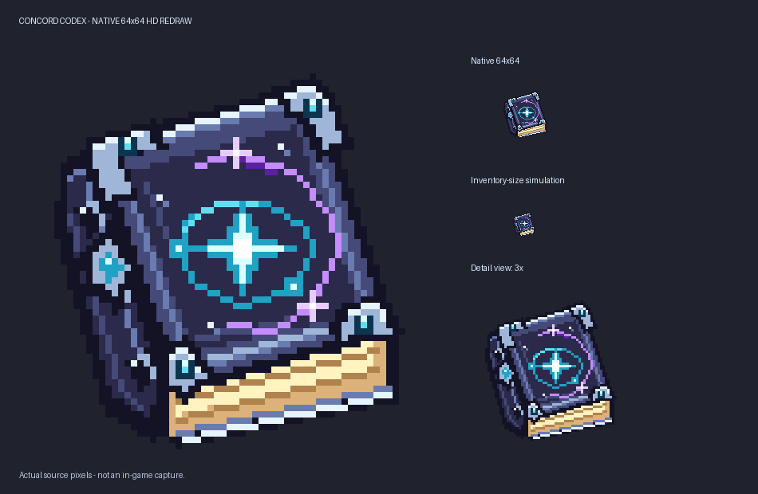

# Concord Codex HD icon

The owner-approved64x64 native redraw replaces the vanilla written-book icon.
It has a navy cover, beveled silver fittings, visible cream pages and a cyan/violet
star-map emblem. This is original64px source art, not a resized concept or32px
texture. Registry ID, lore, quests, book screens and interactions stay unchanged.

Default Design generator: `docs/concord-codex-art/generate.py`. The earlier32px
study is retained as historical code, not the production generator. Future
regeneration must retain the approved64px version and its source hashes.

Checks cover native RGBA size, transparent padding, locked colour ramps, correct
generated-item binding, PNG/model source consistency and production JAR assets.
Painted luminous accents do not emit world light. No new animation or Codex GUI
overhaul is claimed. In-client appearance remains distinct from artwork approval.

The broader TODO remains in [the saved workflow](usage-checkpoint-2026-10-13.md).
Only this approved artwork delivery was continued below the prior usage cutoff.

Same-version1.0.12-dev build and full asset audit passed with zero errors and both
Codex source bindings verified. Installed into ZeroG's mods folder with an old-JAR
backup while Minecraft was closed. No saves, other mods or settings changed.
Archived JAR: `docs/jars/zerog-tweaks-1.21.1-1.0.12-dev-codex-hd-20261013.jar`.
SHA256: `cb2947dfb12ca5ae1c775cb471b7888fb44ed260542d86a4a5af2573ee787148`.
