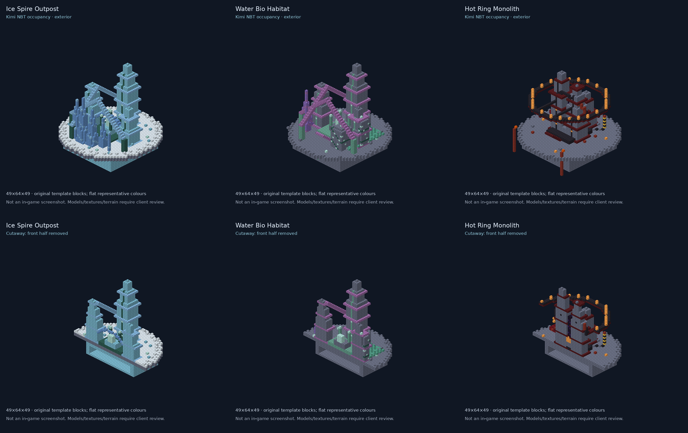

# Kimi structure integration and inspection sites

> Historical source-import receipt. The owner-approved resized custom-block
> revision supersedes these original dimensions and origins. See
> [the revised structure play-test guide](structure-revision-playtest-2026-10-14.md).

The picture is generated from the actual admitted NBT block positions, with
representative flat colours. It is not a Minecraft screenshot, model/texture
renderer or proof of matching the concepts. No new concept art is substituted.

Only three templates were imported from Kimi's local build, not its entire JAR.
Existing compressor lighting/size, cards, gateways and other later fixes remain.

| Command | Template | Destination |
| --- | --- | --- |
| `/zero showcase ice` | ice_spire_outpost | Eidolon |
| `/zero showcase water` | water_bio_habitat | Cerulon |
| `/zero showcase hot` | hot_ring_monolith | Skarn |

Original long names still work. Operator permission2 is required. These read
persisted per-dimension site origins and search the entrance's local surface
for safe two-block player clearance. They do not teleport onto the highest spire
or depend on the old hardcoded512,90,512test location. If the entrance was altered
and obstructed, travel refuses rather than clearing blocks.

In another world where these inspection sites are absent, explicitly request
`/zero showcase ice build`, `water build` or `hot build` first. That is a world
placement operation, unlike ordinary teleport. It searches25 bounded distant
candidates using noise/terrain preflight and returns a clear refusal if none
qualify. It may cause a short cold-generation server pause; it is never run on
every tick or automatically at startup. Repeated builds preserve the existing
site and player edits. Third-party claim integration is not verified.

Ice/hot use gentle dry ground; Water Bio Habitat can use a waterline terrace
supported down to the seabed. Actual authored write cells and foundation columns
reject containers/BE blocks, bedrock and incompatible fluids. Foundation filling
is limited to below the lowest authored solid per column and never fills authored
air corridors. Unsupported deep sites are refused. Template shape is otherwise
Kimi's, not an enlarged version of the rejected localV4drafts.

## Verification boundary

Static checks: all custom asset IDs resolve, no gate blocks in the palettes,
stair anchors retained. Native tests exercise actual placement, entrance travel,
three-block stair clearance, generated chest loot, hostile spawner block entities
and repeated-build preservation. Spawner presence is not a hostile spawning-rate
or gameplay-balance test. Client appearance/terrain blending remains owner review.

This is explicit test-site placement. Natural random generation of these three
large structures is NOT enabled. Existing natural structures and source routes
remain separate. The installer only adds new distant regions to the current
`ZeroG_Fresh_Workshop_20261014_Seed0`save; it refuses any existing target region
or site record. No Overworld hub, player data, old saves or forced tickets are
replaced. Final verification and delivery receipt follows after checks complete.

Final five required tests passed14October, including native terrain/site build,
actual command travel, generated loot, access and preservation of an edit on
repeat build; the disposable server shut down normally. Verified template origins:

| Planet | Origin (not the player arrival point) |
| --- | --- |
| Eidolon |6208,58,7232|
| Cerulon |4160,58,5184|
| Skarn |5184,45,4160|

The named commands choose safe entrance footing relative to these origins.
