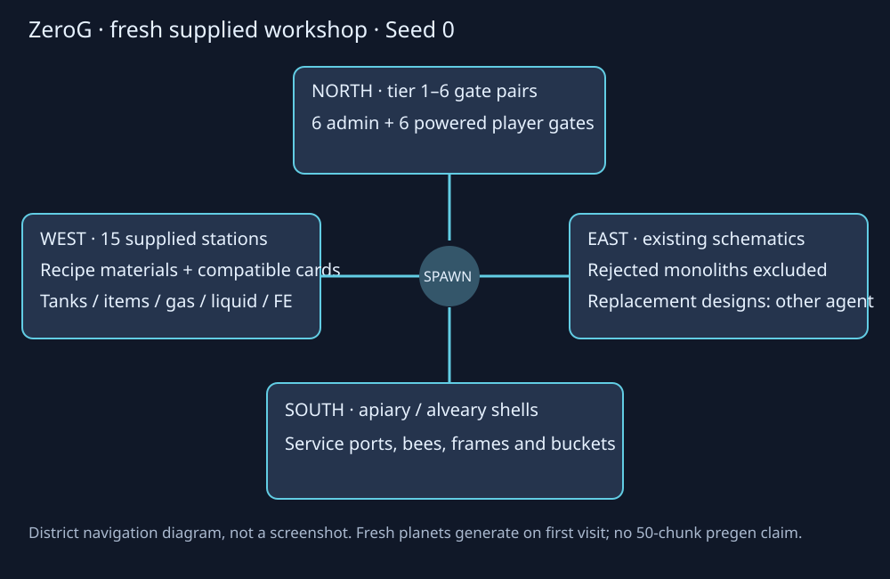

# Maintenance continuation and fresh hub — 14 October

Owner selected compressor review, fresh hub, machine audit, alveary maintenance
and progression/ecology checks. Structure redesign is assigned to another agent;
do not install the rejected templates or these local draft replacements.

## Fresh installed test world

`ZeroG_Fresh_Workshop_20261014_Seed0` (seed0) is a new standalone save, not a
rewrite of a player's world. Three dedicated isolated tests passed with the
installed Productive Bees13.14.0 and orbital-addon1.0.0:

- Six free admin tiers and six normal player gate tiers, formation/routing and
  controller energy through ports.
- The established15 supplied workshop machine stations and southern approved
  apiary/alveary service shells, west transport/tank lanes and eastern existing
  schematics.
- No permanent hub chunk tickets, no automatic34-planet village sweep, and
  preservation of edits when the hub builder is invoked again.

The final fresh hub was regenerated after fixing stale upgrade supplies.
Native processor kits now include compatible Acceleration/Energy Coil/Compact
tier1and6examples plus Void; genetics/legacy processors and separator get only
their supported Acceleration/Energy Coil examples. Casing/dust items are no
longer explicitly offered as upgrades (recipe ingredients remain). Six-tier
gas tubes were added to the service kit. Three final hub tests passed again,
including actual chest-stock assertions. Existing workshop saves are not
automatically refilled or modified by this runtime change.

Only four bounded Overworld regions and the validated hub ledger were exported.
No old planetary chunks, test players, forced tickets, or rejected structure
test regions were copied. All34 planetary dimensions generate fresh on first
visit. This is NOT50chunks-per-planet pre-generation or a natural ecology audit.
After the owner explicitly confirmed permanent deletion without backups, the
six listed former worlds/ZIPs were removed from saves. The two alpha worlds,
old Compact Hub,13October structure workshop and two old hub ZIPs are included.
No new backups of those six were made. Unrelated backups elsewhere were not
deleted. The first draft export of today's new hub was recoverably replaced
after the corrected-card stock checks; this is separate from the six old saves.

## Audit evidence

The source GUI audit checked37 profiles with zero slot-bound/overlap errors.
It is not client rendering approval or proof that every machine has a recipe
page. Progression provenance checked22 item sources and13 configured structure
routes with no unbound progression chest source. The separate route audit has
zero missing source references; the three rejected/new large concept-template
chest tables have no natural jigsaw route and are deliberately not marked done.

The separate recipe/menu/card/alveary maintenance batch passed all18required
tests with both optional mods installed; its disposable server shut down normally.
It covered exact loaded combinations/catalysts/yields, legacy card limits and
reload,27frame migration, actual PB production/honey persistence and original
ZeroG service-port buffer transfers. This delivery retains the compressor hotfix;
manual insertion/white-trim client confirmation is still pending. No new
gameplay implementation is implied by rerunning existing boundary tests.

## Still pending

- Advanced bee research milestone mappings, climate/lifespan/territory rules
  and seven-wide alveary layouts. Prior owner decision keeps undefined rules
  pending: do not invent them or activate speculative progression.
- Remaining machine recipe-page coverage and client menu/layout review.
- Multi-seed natural villages, mines, ecology and survival progression journey;
  source references and controlled tests are not natural placement evidence.
- The other agent's concept-faithful structures, grounding/collision/loot/mobs,
  natural registration and eventual hub incorporation.
- Exact survival recipe costs and finalalpha client approval.

## Same-version delivery

Normal build passed and optional maintenance fixtures/classes were excluded.
Installed while the client was closed, with an old-JAR backup; other mods remain
unchanged. JAR: `jars/zerog-tweaks-1.21.1-1.0.12-dev-fresh-hub-20261014.jar`.
SHA256: `ff4565f3c774a9891274dffd9c1cf2ac898eeb929e7e7caf6db0479a745aef14`.
