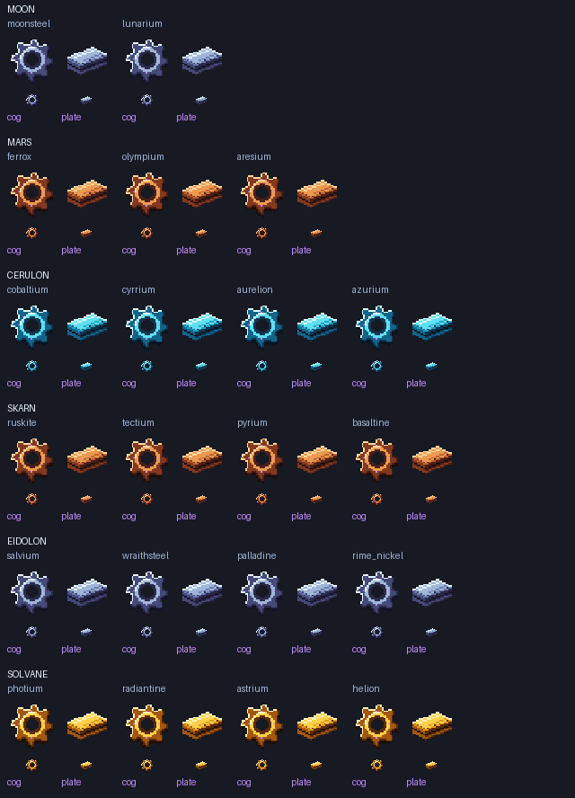

# Planetary cogs and compressed plates

> Follow-up: [manual fabrication and selected progression casings](manufacturing-progression-recipes-2026-10-11.md) now enable these parts using the starting costs the owner continued with. The pending-fabrication text below describes this earlier item-only delivery, not the current build.

42 new manufacturing ingredients cover 21 existing dimension metals. Find them in **ZeroG: Ingredients**. Each has a native 32×32 sprite and a generated-item model that uses that same image in inventory and in the world.

| Origin | Eligible metals |
| --- | --- |
| Moon | Moonsteel, Lunarium |
| Mars | Ferrox, Olympium, Aresium |
| Cerulon | Cobaltium, Cyrrium, Aurelion, Azurium |
| Skarn | Ruskite, Tectium, Pyrium, Basaltine |
| Eidolon | Salvium, Wraithsteel, Palladine, Rime Nickel |
| Solvane | Photium, Radiantine, Astrium, Helion |

IDs follow `zerog_tweaks:<metal>_cog` and `zerog_tweaks:<metal>_plate`. For example: `/give @s zerog_tweaks:moonsteel_cog` and `/give @s zerog_tweaks:moonsteel_plate`. No vanilla metals, Overworld Nullifite or gems are included.

The eight-tooth cogs have a transparent bore, bevel shading and restrained violet inlays; the compressed plates show a lit upper surface, darker side faces and thin stacked edges. Original approved six-tone palettes are used without flat brightness recolouring. Accents are painted pixels, not a claim of actual emitted light. This is a source-art contact sheet, not an in-game capture.

## Manufacturing remains pending

These are registered components, **not yet survival-craftable parts**. Exact survival recipe costs remain deferred as requested. No new compressor, manufacturing process, progression shortcut or changed existing machine recipe is included.

Before enabling manufacturing, agree the equipment and exact ingot quantities for compression/cog fabrication, FE and processing times, catalyst rules, and how successive story stages increase assembly difficulty. Future machines should consume dimension-appropriate parts rather than vanilla metals, with progressively harder costs. Keep this separate from the existing planetary material/tool ladder.

## Verification

The component contract checks the exact whitelist, gem exclusions, registration order, all 42 model-to-PNG bindings, names, group tags, native resolution, transparent padding, colour detail and built-JAR consistency. Full asset audit and clean build are required before delivery. Client visual approval is separate; no saves or hub regeneration is required for this additive ingredient batch.

Source art/generator: [Design manufacturing components](https://github.com/ZeroG-Network-PTY-LTD/ZeroG-Tweaks/tree/Design/docs/manufacturing-components). Runtime registry: [1.21.x source](https://github.com/ZeroG-Network-PTY-LTD/ZeroG-Tweaks/blob/1.21.x/src/main/java/net/zerog/tweaks/registry/ZGManufacturingComponents.java).

## Delivery receipt

Clean build passed in 47 seconds (`20261011_050713_clean.log`); the resource-format follow-up build passed in 43 seconds (`20261011_050849_build.log`). Both component contract tests passed against the final JAR. Asset audit checked 8,021 models, 1,529 blockstates, 4,005 PNGs and 130 animation metadata files, with zero errors. No isolated gameplay test or client visual test is claimed for this additive item-only batch.

Installed the same `1.0.12-dev` JAR with Minecraft closed. Previous JAR is recoverable in `ZeroG/zerog-mod-backups/20261011-051008-UTC`. Dependencies, hub and all saves are unchanged. Final SHA256: `02f146ef3f24f9a9bff31667cfa2fb558bc72cfdbe7a65a5ed0e5c97294fb880`. [Asset report](reports/manufacturing-assets-20261011.json) · [Install receipt](reports/manufacturing-install-20261011.json).
