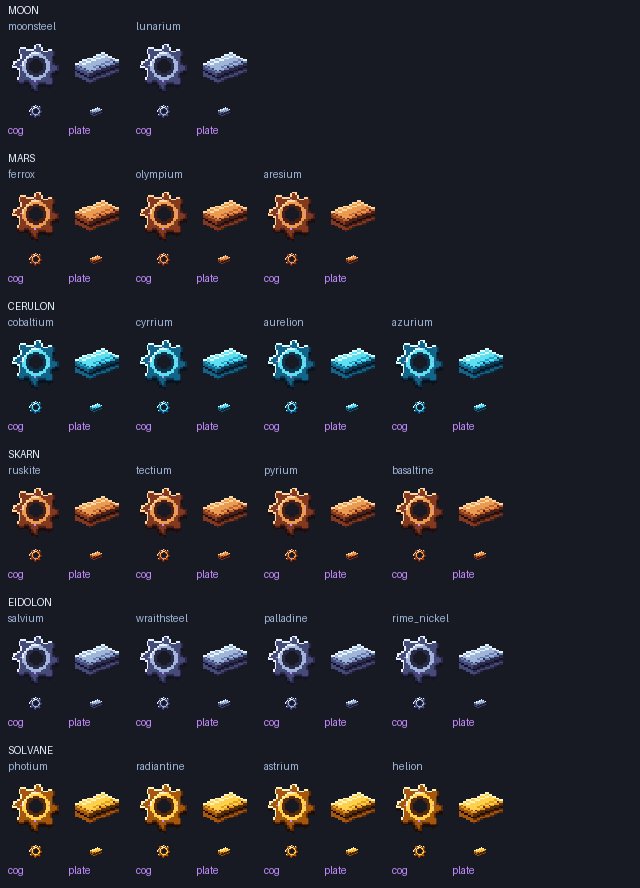

# Dimension-metal manufacturing components

Original native 32×32 artwork for 21 metal families, two parts per family: an eight-tooth machined cog and a thin, layered compressed plate. Transparent cog bores, balanced silhouettes, pale bevels, hue-shifted shadows and selective violet cog inlays follow the approved C direction. These are ordinary generated-item models, so inventory and dropped-item faces use the same texture. Painted accents are not runtime light emission.

The generator uses the exact approved `art-direction/generator/style_kit.py` ramps. Moon/Eidolon use Moonsteel, Mars/Skarn copper, Cerulon Cerulite and Solvane Solvanite. Metals in a planetary group deliberately share its approved palette; no new palettes were invented. `manifest.json` records every ID, source planet and palette.

Run `python3 docs/manufacturing-components/generate.py --code /absolute/path/to/1.21.x-checkout` from Design. This emits retained source PNGs plus runtime models, PNGs, English names and item tags. Run after older general-art batches so they cannot overwrite these components.

Only existing dimension-origin ingot metals are eligible. Overworld Nullifite, iron, copper, gold and all gemstone families are excluded. These new parts do not change tool tiers or make gate progression cheaper.

Fabrication is intentionally pending: exact survival costs were deferred by the owner. There is no compressor machine in this batch and no invented shapeless “compression” recipe. Future machines should use the corresponding planet metals and harder story-aligned assembly steps as progression advances; agree quantities, energy, catalysts and fabrication equipment before enabling survival recipes.
