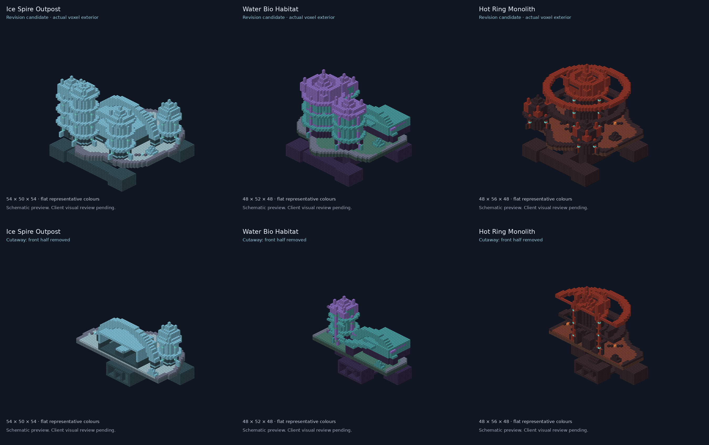

# Revised planetary structures — play-test



The image projects actual NBT blocks with representative colours. It is not a
Minecraft screenshot or an exact texture preview. The owner accepted the drafts
for now, requesting custom ZeroG architecture and terrain blending.

| Site | Planet | Width × length × height | Underground depth |
| --- | --- | --- | --- |
| Bio-habitat | Cerulon | 48 × 48 × 52 | 16 |
| Crimson monolith | Skarn | 48 × 48 × 56 | 20 |
| Cryogenic outpost | Eidolon | 54 × 54 × 50 | 14 |

All building/landscape palettes use ZeroG blocks. Air, chest and spawner blocks
retain vanilla mechanics. Darker foundations, lighter crowns, grouped weathering,
chiseled ribs, openings, buttresses, lamps, clustered native growth and irregular
terrain edges replace the original single-tone draft. These are explorable test
sites, not a claim of exact concept reproduction.

## Visit the prepared sites

Open `ZeroG_Fresh_Workshop_20261014_Seed0` with operator commands available:

```text
/zero showcase water
/zero showcase hot
/zero showcase ice
```

Commands use saved origins and safe ground-level entrance offsets, not the tops
of towers. Four underground loot rooms and one hostile spawner belong to each
site; no dimension gates are placed inside these structures.

For another new save, explicitly prepare a site first:

```text
/zero showcase water build
/zero showcase hot build
/zero showcase ice build
```

Build commands alter a bounded distant area after terrain/container checks;
ordinary teleport commands never build. Repeated build requests preserve edits.
These three large structures do not yet randomly generate throughout planets.
Existing natural structures/villages remain a separate generation system.

## Slight ecology adjustment

Village selection tries two extra deterministic dry/gentle alternatives, while
retaining one selected site per 50×50-chunk region. It does not place every
candidate or create clustered villages. This is a small improvement in suitable
site availability, not a measured guarantee of more natural villages.

Ordinary group maxima increase by one for Mossback in Azure Plains, Rime Stalker
in frozen wastelands and Ash Strider in volcanic wastelands. Rare blazes, mob caps,
gate safety and custom-weather pause are unchanged. New village placement affects
new chunks only; existing player exploration is not erased.

## What to inspect

1. Walk from the entrance down the stair to all four loot rooms. Open chests;
   check headroom, room proportions and terrain seams.
2. Inspect each façade, crown, ring/arch, foliage and lighting in the client.
   Upper-tower access and spawn/light balance still need player review.
3. Explore new chunks for villages, mines and planet-native mobs. A rare village
   may require significant travel; absence near a gate alone is not a failure.
4. At the hub, test Industrial Compressor: reusable Plate Press plus 2 matching
   ingots yields 1 plate; Cog Press plus 4 ingots yields 1 cog. Non-front faces
   accept configured item/power routing. Check both processing and chamber visuals.

The accepted compressor lighting/size and recipes are preserved. The piston/result
animation timing remains deferred, as requested; this update does not claim it fixed.

## Evidence and delivery

Five isolated native tests passed: real site placement, safe command arrival,
generated chest contents, stair clearance, repeat-build preservation and bounded
repeatable village selection. Static routes also reach all four loot rooms.
This does not certify natural structure frequency, upper-level traversal or
installed-client appearance. Final build/install receipt is recorded separately.

A second isolated run passed all 22 required checks, including actual compressor
processing, reusable dies, menu/automation boundaries and native structure stair
and chest-approach collision checks. Both disposable servers shut down normally.

Installed same-version `1.0.12-dev` JAR SHA256:
`a78b9d0fc9bd7e2a26e601b56b8ef227a198d5dfe27352f0e8f92277d0586dd7`.
The previous installed JAR is recoverable under the instance's
`zerog-mod-backups/20261014-055303-UTC/`. Only nine new distant planetary
region/entity/site-data files were added; existing target files were refused.
Overworld, player data, other mods and existing exploration were preserved.

| Site | Saved origin (entrance offset is added by the command) |
| --- | --- |
| Hot / Skarn | 6208, 38, 4160 |
| Water / Cerulon | 4160, 54, 5184 |
| Ice / Eidolon | 6208, 56, 7232 |
