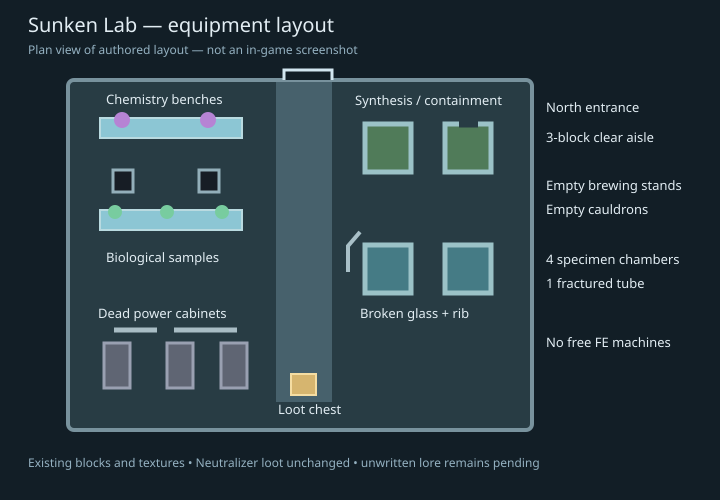

# Sunken Lab — abandoned chemistry and biological laboratory

The owner's laboratory request is implemented as two original29×12×25 layouts, not another generic shelter. Existing Sludgestone and hull blocks form the low foundation, damaged shell and clear service aisle. The equipment is deliberately zoned:

- Chemistry: long workbenches, two empty vanilla brewing stands and two empty cauldrons.
- Biology: seven potted mushroom samples, including four inside containment chambers.
- Synthesis: four green/cyan glass chambers with solid bases and caps; one fractured tube per variant and a separate exposed rib remnant.
- Power room: three dead cabinet shells, visible coils and a disconnected cable tray.
- Archive: one accessible chest with the unchanged Sunken Lab loot table and Neutralizer reward.



The three-block spine stays clear. Damage changes between variants: a different roof breach and broken chamber opening. Two existing Pulsar Lamps light the room. No new textures, named specimens, story logs, Broken Console, Wisp, bosses or research rules are invented.

Dead cabinets, glass tubes and cable scenery are architecture, **not working ZeroG power/storage machines**. Vanilla brewing stands and cauldrons retain normal player interaction, but start empty and do not supply free fuel, potions or fluids. No damaging acid sources are placed in the room.

## Placement

Existing Acid Swamps, Mud Flats and Moss Bogs are eligible. The current jigsaw implementation places the ruin on dry ground with a low terrain-blending foundation; it does not flood it with acid or place it underwater. Terrain tolerance6, bounded search32, `always_place=false`, spacing40/separation20,salt19477408. This is a candidate grid, not guaranteed density.

Explore newly generated toxic terrain, or use the operator locator:

```mcfunction
/execute in zerog_tweaks:g2_p5 run locate structure zerog_tweaks:sunken_lab
```

## Evidence boundaries

Focused tests passed both variants in all rotations: service-spine floor/headroom, actual empty apparatus, four chamber bases/caps, broken glass opening, chest lid and Neutralizer loot (`20261011_092129_runWorkflowTests.log`, one required test). Two source contracts passed, verifying original palettes, source/runtime bytes, existing toxic biomes and absence of working power-machine giveaways. Normal clean build passed (`20261011_092526_clean.log`). Natural-generation sampling remains pending; a registered placement route is not proof of a generated site.

Broader seeds, all habitats, actual client appearance and full biological/research gameplay remain pending. Sunken Relay is the last dedicated wasteland ruin still missing. This batch does not change weather, gates, recipes, daily comet events or the hub/save terrain.

## Delivery

Same-version `1.0.12-dev` installed with the preceding JAR backed up outside `mods` at `zerog-mod-backups/20261011-092718-UTC`. Dependencies and saves were untouched. Asset audit: zero errors; three manufacturing regressions passed. [Install receipt](reports/sunken-lab-install-20261011.json) · [Asset report](reports/sunken-lab-assets-20261011.json) · [Build JAR](jars/zerog-tweaks-1.21.1-1.0.12-dev-sunken-lab-20261011.jar).

[Editable layout generator](https://github.com/ZeroG-Network-PTY-LTD/ZeroG-Tweaks/blob/Design/docs/wasteland-ruins/generate_sunken_lab.py) · [route graph](reports/sunken-lab-routes-20261011.json).
