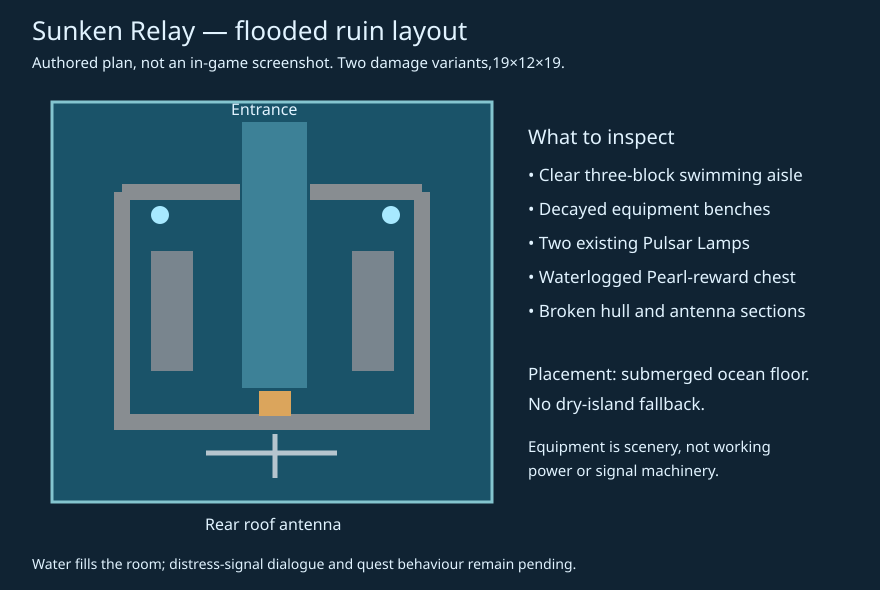

# Sunken Relay — submerged communications ruin

The relay's two original layouts are flooded, not surface shelters or underwater air bubbles. Existing ocean stone and corroded hull enclose decayed equipment benches, a damaged antenna and a clear swimming route to the existing Abyssal Pearl chest reward. Waterlogged chest and antenna ribs preserve the underwater appearance. Two existing Pulsar Lamps help identify the entrance.



Equipment is decorative architecture. The ruin supplies no working power cells, gate controllers or free biological machines. No existing loot chances, mining tiers, weather, gates or recipes are changed.

## Discover it

Explore new ocean-wasteland chunks in Deep Trenches, Kelp Jungles or Island Chains. The default Galaxy2 ocean is `g2_p1`:

```mcfunction
/execute in zerog_tweaks:g2_p1 run locate structure zerog_tweaks:sunken_relay
```

The new submerged placement type uses ocean-floor height,25 bounded sample columns, a maximum6-block seabed variation and water above even the antenna. Dry or shallow sites are rejected; there is no forced-placement fallback. Spacing40/separation20 is a candidate grid, not guaranteed density. Approved dry-land structures remain on their existing placement type.

## Evidence and pending work

Three source contracts passed. One required server test passed both variants in four rotations: flooded swimming aisle, waterlogged chest/antenna, free chest lid and actual guaranteed Abyssal Pearl (`20261011_093527_runWorkflowTests.log`). Optional GameTest code/fixtures are excluded from the production JAR. Ordinary natural-generation sampling is a separate check; neither authored templates nor compile success prove natural ocean placement or client appearance.

The first ordinary locator exposed a zero-depth jigsaw builder error (`20261011_093835_runServer.log`). It was confined to a disposable world, stopped normally, and was not installed. The corrected placement uses depth1 and rejects empty builders before calculating bounds; a regression contract now protects both conditions. Final natural-world verification uses a separate fresh directory, not that failed test world.

The corrected clean build passed (`20261011_094037_clean.log`). A fresh ordinary, structure-enabled seed-zero server located the Relay at `(128,32)` in `g2_p1`, start chunk `(8,2)`.49 saved FULL chunks contain one natural Relay piece and its unopened reward chest at `(142,66,23)` inside the piece bounds. A nearby Observatory-table mine chest is counted separately. [Natural site report](reports/natural-sunken-relay-20261011.json).

The saved piece occupies `(128,64,14)` through `(146,75,32)`. All25 bounded sample columns had water above the piece and non-air/nonfluid blocks below the foundation. This is saved-site evidence, not proof of every block or every seed. [Water/support samples](reports/sunken-relay-water-support-20261011.json). Actual Pearl rolls were checked in the focused placements; this natural chest remains unopened.

All temporary force loads were removed, the disposable world flushed and its server stopped normally (`20261011_094132_runServer.log`). Source contracts for Lab, Observatory, Impact Site and frozen-biome eligibility also passed; three manufacturing regressions passed. No player save/hub changes were required.

The design's still-broadcasting distress signal remains a story/gameplay TODO: its message and interaction/quest consequences have no approved specification. The antenna is scenery, not a completed signal system. No invented Broken Console log or coordinates close that gap.

Broader seeds, all ocean habitats and client visual/swimming approval remain pending. Existing saves and hub terrain are not regenerated by this batch.

[Editable generator](https://github.com/ZeroG-Network-PTY-LTD/ZeroG-Tweaks/blob/Design/docs/wasteland-ruins/generate_sunken_relay.py)

## Delivery

Same-version `1.0.12-dev` installed into ZeroG with the preceding JAR backed up outside `mods` at `zerog-mod-backups/20261011-094414-UTC`. Saves, dependencies, approved gates and paused weather were untouched. Final asset audit: zero errors. [Install receipt](reports/sunken-relay-install-20261011.json) · [Asset report](reports/sunken-relay-assets-20261011.json) · [Route graph](reports/sunken-relay-routes-20261011.json) · [Build JAR](jars/zerog-tweaks-1.21.1-1.0.12-dev-sunken-relay-20261011.jar).
